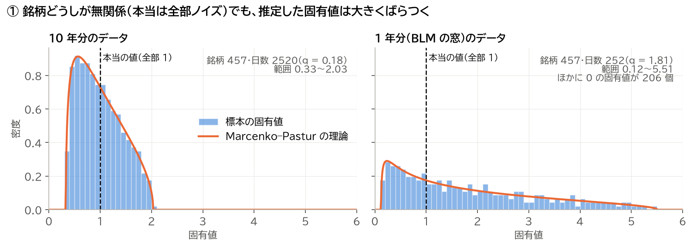
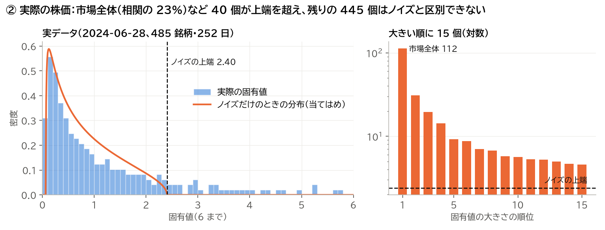
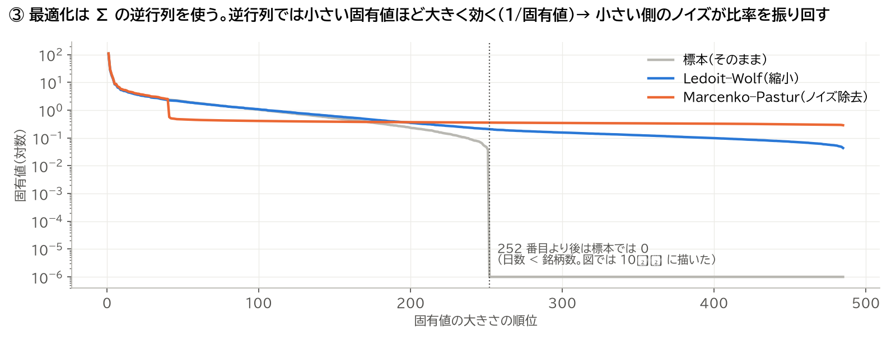
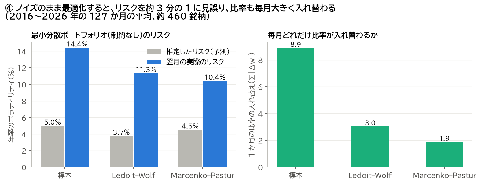

# 共分散のノイズ除去が要る理由

4 枚の図で説明する。図は `figures/` にあり、`../figs.py` で作り直せる。数値の出どころは `summary.json`（X01 の比較）。

## ① ノイズだけでも、固有値はばらつく

- 457 銘柄が**互いにまったく無関係**な、作ったデータである。本当の固有値は全部 1（点線）。
- それでも、推定すると固有値は広がる。
  - **10 年分**（2,520 日）：0.33〜2.03 に広がる。
  - **1 年分**（252 日、BLM の窓）：0.12〜5.5 まで広がり、さらに **206 個が 0** になる。
- オレンジの線は Marcenko–Pastur の理論で、ばらつき方を当てている。範囲は、銘柄の数 ÷ 日数（q）だけで決まる。

**データの量が足りないだけで、何もないところに大小の差ができる。**

## ② 実際の株価：飛び出しているのはごく一部

2024 年 6 月末の S&P500（485 銘柄、252 日）の相関行列である。

- 最大の固有値は 112 で、相関全体の 23% を占める。**市場全体が一緒に動く成分**（ベータ）である。
- 次の数個は、セクターなどのまとまり。
- ノイズの上端（2.40）を超えたのは 40 個。**残りの 445 個はノイズの山の中**にあり、本物の関係かどうか区別できない。

左の図で、オレンジの理論の線と青の山が完全には合わないのは、銘柄ごとにノイズの大きさが違うからである。Marcenko–Pastur は「ノイズの大きさが全銘柄で同じ」と仮定しているので、実際の株価ではノイズの山が上端の外まで広がり、上端を超える固有値が多めに出る。株式の本当の因子は 10 個前後と言われるが、ここでは 40 個が残った（X01 の全期間で平均 42 個）。

## ③ 最適化が困るのは「小さい固有値」の側

最適化は Σ の**逆行列**を使う。逆行列では固有値が 1/固有値 になるので、**小さい固有値ほど結果に大きく効く。**

- **灰色（標本のまま）**
  - 252 番目より後が 0 になる（日数 < 銘柄数）。0 の逆数は無限大で、計算が成り立たない。
  - 0 の手前の小さい値も、ノイズで偶然小さくなっただけなのに、逆行列では巨大になる。
  - 最適化は「この方向はリスクがほぼない」と誤解して、そこに大きく賭ける。
- **青（Ledoit–Wolf、今の BLM）**：全体を真ん中へ引き寄せて、小さい固有値を持ち上げる。
- **オレンジ（Marcenko–Pastur）**：上位 40 個（本物）はそのまま残し、残りのノイズを全部平均の値にそろえる。だから途中で段差ができる。

## ④ その結果、何が起きるか

制約のない最小分散ポートフォリオを、2016〜2026 年の 127 か月の月末に作り、翌月の値動きで確かめた（平均約 460 銘柄）。

- **左：リスクの見誤り**
  - 標本のままだと、推定したリスクは 5.0% なのに、翌月の実際は 14.4%。**リスクを約 3 分の 1 に見誤る。**③ の「リスクがほぼない方向」が、実際にはリスクがあったからである。
  - ノイズを除くほど、実際のリスクも下がる（14.4% → 11.3% → 10.4%）。
- **右：比率の振れ**
  - 標本のままだと、毎月の比率の入れ替え（Σ|Δw|）が 8.9 になる。
  - ノイズは毎月変わるので、比率もそれに振り回される。Ledoit–Wolf で 3.0、Marcenko–Pastur で 1.9 に下がる。

## まとめ

**ノイズ除去が要るのは、最適化がノイズを本物と区別せず、ノイズでできた「安全そうに見える方向」に全力で賭けてしまうからである。**推定の誤差を、最適化が増幅する。

ただし、制約があると話が変わる。

| | 標本 | Ledoit–Wolf | Marcenko–Pastur |
|---|---|---|---|
| 制約なしの最小分散：実際のリスク | 14.4% | 11.3% | **10.4%** |
| 空売りなしの最小分散：実際のリスク | 10.5% | **10.5%** | 10.6% |
| BLM の最適化（TE の上限 3%）：実際の TE | 4.8% | **4.5%** | 4.7% |

- 空売りの禁止や TE の上限があると、**制約そのものが大きな賭けを抑える**。そのため、ノイズ除去の差はほとんど消える。空売りなしなら、標本のままでも Ledoit–Wolf との差は 0.08 ポイントしかない（Jagannathan–Ma 2003 の知られた結果）。
- **BLM は空売りなしで TE の上限もあるので、今の Ledoit–Wolf のままでよい。**『ファイナンス機械学習』のノイズ除去は、制約の弱い最適化ほど効く、と読むとよい。
- どの推定でも、実際の TE は上限 3% の約 1.5 倍（4.5〜4.8%）になった。過去 1 年から推定した共分散は、翌月のリスクの変化を捉えきれない。BLM の結果を報告するときは「TE 3%」ではなく、実際の値を書く。

詳しい数値と限界は `findings.md`。
